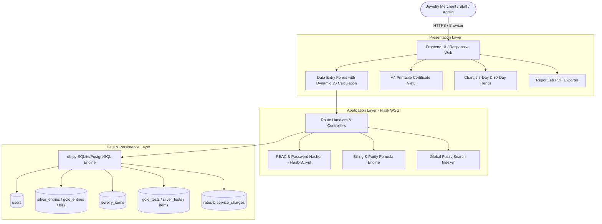
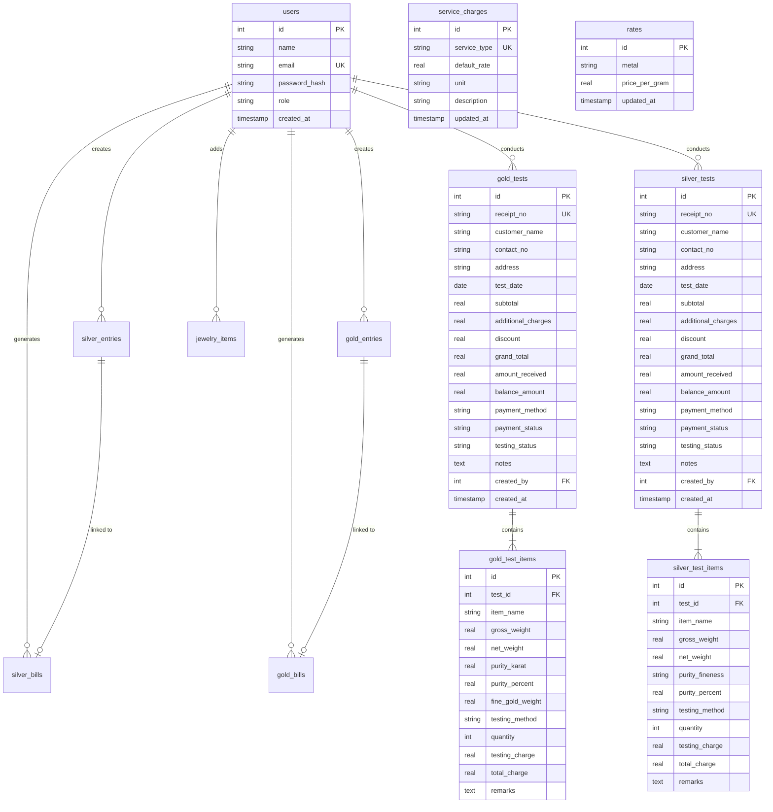
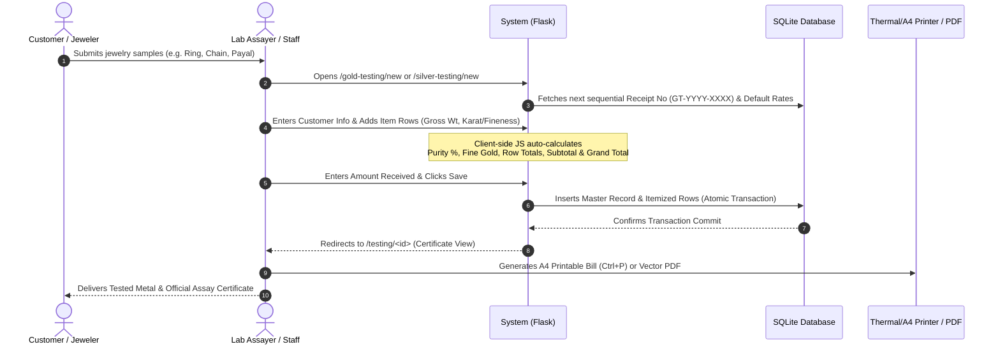

# 💎 Siddhanth Firm (श्री सिद्धनाथ बुलियन टंच) – Software Architecture & System Design Document (DESIGN.md)

**Project Name:** Siddhanth Firm Business Management & Assay Billing System  
**Version:** 2.1.0  
**Author / Architect:** Senior Full-Stack Developer & Business Software Architect  
**Classification:** Enterprise Precious Metals, Polish & Computerized Assay Management System  

---

## 1. System Overview & Architectural Objectives

Siddhanth Firm operates in the precious metals sector, specializing in five core business operations:
1. **Silver Polish Services (चाँदी पॉलिश)** – Weight tracking, processing, gram price, and billing.
2. **Gold Polish Services (सोना पॉलिश)** – Weight tracking, processing, and billing.
3. **Jewelry Box Inventory (ज्वैलरी बॉक्स)** – Stock management, retail pricing, and customer billing.
4. **Gold Testing Services (स्वर्ण टंच / शुद्धता परीक्षण)** – Computerized XRF assay, Karat/purity calculations, fine gold calculations, multi-item receipts, and certificates.
5. **Silver Testing Services (रजत टंच / शुद्धता परीक्षण)** – Scientific assay testing, fineness (*प्रति हजार टंच* / e.g. 61|70, 800, 925), multi-item receipts, and certificates.

### Key Architectural Tenets
- **Data Preservation:** Zero disruption to existing production database records.
- **Relational Integrity:** Foreign keys with `ON DELETE CASCADE` between test receipts and test items.
- **Bilingual Legal Compliance:** Certificates formatted in both Hindi/Marathi (*देवनागरी*) and English for standard Indian jewelry market compliance.
- **Multi-Output Rendering:** Identical data model rendered dynamically in HTML, print-optimized A4 (`@media print`), and vector ReportLab PDF documents.
- **Single Source of Truth:** Live database calculation for dashboard metrics, financial totals, and 30-day analytics.

---

## 2. High-Level Architecture

The system utilizes an asynchronous MVC (Model-View-Controller) multi-tiered architecture:



---

## 3. Technology Stack & Component Selection

| Layer | Component | Description & Rationale |
|---|---|---|
| **Backend Framework** | Python 3.11+ / Flask 3.0.3 | Lightweight, fast WSGI microframework offering fine-grained control over endpoints and routing. |
| **Authentication & Security** | Flask-Bcrypt 1.0.1 | Salted one-way bcrypt password hashing for administrative and staff accounts. |
| **Database** | SQLite 3 / PostgreSQL (Neon ready) | Native SQLite support with connection type converter (`DATE`, `TIMESTAMP`) and full foreign-key support. |
| **Vector PDF Generation** | ReportLab 4.2.2 | Industrial-grade vector PDF rendering with exact centimeter margins (`SimpleDocTemplate`, `Table`, `TableStyle`). |
| **Frontend Templates** | Jinja2 | Server-side templating ensuring rapid First Contentful Paint (FCP) and seamless state delivery. |
| **Styling & Print Engine** | Custom CSS3 + `@media print` | Tailored typography, responsive CSS grid, flexbox, and print stylesheets formatting standard A4 pages. |
| **Data Visualization** | Chart.js 4.4.0 (UMD) | Canvas-based animated multi-dataset charts for daily trends and monthly financial reporting. |

---

## 4. Entity-Relationship (ER) Data Model



---

## 5. Mathematical Formulations & Billing Engine

### 5.1 Polish Billing Formulas

#### Silver Polish Billing
$$\text{Total Amount} = (W_{\text{silver}} \times P_{\text{silver}}) - W_{\text{waste}} + W_{\text{extra}} + (W_{\text{gram}} \times P_{\text{gram}})$$
- $W_{\text{silver}}$: Gross Silver Weight (grams)
- $P_{\text{silver}}$: Silver Polish Rate per gram
- $W_{\text{waste}}$: Waste Deduction amount (₹)
- $W_{\text{extra}}$: Extra Weight surcharge (₹)
- $W_{\text{gram}}, P_{\text{gram}}$: Added silver gram weight and unit price

#### Gold Polish Billing
$$\text{Total Amount} = (W_{\text{gold}} \times P_{\text{gold}}) + (W_{\text{gram}} \times P_{\text{gram}})$$

---

### 5.2 Testing Services (Assay & Tunch) Formulas

#### Gold Purity & Fine Gold Conversion
Given Karat rating $K \in (0, 24]$:
$$\text{Purity Percentage } (\%) = \left(\frac{K}{24}\right) \times 100$$
$$\text{Fine Gold Weight } (g) = W_{\text{net}} \times \left(\frac{\text{Purity Percentage}}{100}\right) = W_{\text{net}} \times \left(\frac{K}{24}\right)$$

#### Silver Fineness Conversion
Indian bullion assay uses *प्रति हजार टंच* (parts per 1,000):
$$\text{Purity Percentage } (\%) = \frac{\text{Fineness (per mille)}}{10}$$
*Example:* A marking of `61 | 70` corresponds to $617.0\text{‰} = 61.70\%$.  
*Sterling Silver:* $925\text{‰} = 92.50\%$.  
*Fine Silver:* $999\text{‰} = 99.90\%$.

#### Invoice Financial Balance
For $N$ items on a single testing receipt:
$$\text{Subtotal} = \sum_{i=1}^{N} \left(\text{Quantity}_i \times \text{Rate}_i\right)$$
$$\text{Grand Total} = \text{Subtotal} + \text{Additional Charges} - \text{Discount}$$
$$\text{Remaining Balance} = \max\left(0,\, \text{Grand Total} - \text{Amount Received}\right)$$

$$\text{Payment Status} = 
\begin{cases} 
\text{"Paid"}, & \text{if } \text{Remaining Balance} = 0 \\
\text{"Partial"}, & \text{if } \text{Amount Received} > 0 \text{ and } \text{Remaining Balance} > 0 \\
\text{"Unpaid"}, & \text{if } \text{Amount Received} = 0 
\end{cases}$$

---

## 6. Business Workflow & State Transitions

### 6.1 Assay Testing Lifecycle



---

## 7. UI / UX Design Specifications

### 7.1 Visual Hierarchy & Design System

The user interface follows a modern dark sidebar navigation with high-contrast, clean administrative cards:

| Token | Value | Applied To |
|---|---|---|
| `--gold` | `#D4AF37` / `#B8860B` | Gold Polish, Gold Testing, Revenue badges, Karat values |
| `--silver` | `#64748B` / `#334155` | Silver Polish, Silver Testing, Fineness markings |
| `--navy-dark` | `#1A1A2E` | Table headers, primary invoice borders, brand titles |
| `--bg-light` | `#F8F9FA` | Form backgrounds, summary computation cards |
| `--font-primary` | `'Poppins', sans-serif` | Clean, modern sans-serif typography across all viewports |
| `--accent-red` | `#D90429` | Outstanding balance amounts, delete actions |
| `--accent-green` | `#2A9D8F` / `#059669` | Paid status badges, amount received |

### 7.2 Printable A4 Certificate Specifications (`@media print`)

```css
@media print {
    body, html {
        background: #ffffff !important;
        color: #000000 !important;
        margin: 0 !important;
        padding: 0 !important;
        -webkit-print-color-adjust: exact !important;
        print-color-adjust: exact !important;
    }
    .sidebar, .top-bar, .no-print, .page-header, .page-actions, .flash-message {
        display: none !important;
    }
    .printable-card {
        border: 1.5px solid #000 !important;
        box-shadow: none !important;
        margin: 0 auto !important;
        width: 100% !important;
        max-width: 100% !important;
        padding: 1cm !important;
        page-break-inside: avoid;
    }
}
```

---

## 8. API & Route Endpoints Reference

### 8.1 Authentication & System
- `GET /login`, `POST /login` – Authenticates user credentials via bcrypt; sets session cookies.
- `GET /logout` – Destroys session; redirects to login.
- `GET /dashboard` – Aggregates 5-arm revenue, pending tasks, 7-day trend arrays, and recent transactions.
- `GET /settings`, `POST /settings` – Manages metal rates (`update_rates`), testing charges (`update_testing_charges`), and user provisioning.
- `GET /reports` – Computes daily and 30-day cumulative revenue summaries and customer billing charts.
- `GET /api/search?q=<query>` – Returns instant JSON search results across all modules.

### 8.2 Gold Testing
- `GET /gold-testing` – List of gold testing records with date and text filters.
- `GET /gold-testing/new`, `POST /gold-testing/new` – Form and handler for new gold testing receipts.
- `GET /gold-testing/<id>` – Interactive and printable A4 assay certificate.
- `GET /gold-testing/<id>/pdf` – ReportLab vector PDF download.
- `GET /gold-testing/sample` – Preloaded realistic demonstration bill.
- `POST /gold-testing/<id>/delete` – Admin-only record deletion.

### 8.3 Silver Testing
- `GET /silver-testing` – List of silver testing records with date and text filters.
- `GET /silver-testing/new`, `POST /silver-testing/new` – Form and handler for new silver testing receipts.
- `GET /silver-testing/<id>` – Interactive and printable A4 assay certificate.
- `GET /silver-testing/<id>/pdf` – ReportLab vector PDF download.
- `GET /silver-testing/sample` – Preloaded realistic demonstration bill.
- `POST /silver-testing/<id>/delete` – Admin-only record deletion.

---

## 9. Security, Data Validation & Concurrency

1. **Role-Based Access Control (RBAC):**
   - `@login_required`: Enforces authenticated sessions on all operational views.
   - `@admin_required`: Restricts deletion endpoints, metal price updates, testing charge modifications, and user creation exclusively to users with `role = 'admin'`.
2. **Transaction Isolation:**
   - Multi-item inserts run within SQLite transactions (`conn.execute` statements followed by atomic `conn.commit()`), with `conn.rollback()` invoked on exception handlers.
3. **Receipt Uniqueness:**
   - Both `gold_tests.receipt_no` and `silver_tests.receipt_no` enforce `UNIQUE` constraints at the database level.
4. **Input Sanitization:**
   - Parameterized SQL queries (`?`) prevent SQL injection attacks throughout the system.

---

## 10. Verification & Quality Assurance Suite

Automated integration tests are maintained in [test_system.py](file:///c:/01%20Pratik/CLG/Projects/Sidhanth%20Ferm/test_system.py):

```bash
python -m unittest test_system.py
```

### Verified Scenarios:
- `test_01_dashboard_integration`: Validates live query calculations for tests, revenue, and quick actions.
- `test_02_gold_testing_list`: Tests query filtering and customer lookup.
- `test_03_gold_testing_new_entry`: Tests multi-item row insertion, automatic computation, and DB persistence.
- `test_04_gold_testing_sample_bill_and_pdf`: Verifies sample bill rendering and ReportLab binary PDF stream.
- `test_05_silver_testing_list`: Validates silver testing history and table formatting.
- `test_06_silver_testing_new_entry`: Validates multi-item silver receipts and fineness string parsing.
- `test_07_silver_testing_sample_bill_and_pdf`: Verifies silver sample bill rendering and PDF generation.
- `test_08_existing_modules_intact`: Confirms non-regression across Silver Polish, Gold Polish, Jewelry Box, and Settings.
- `test_09_api_search_includes_testing`: Ensures global search resolution for gold and silver receipts.

